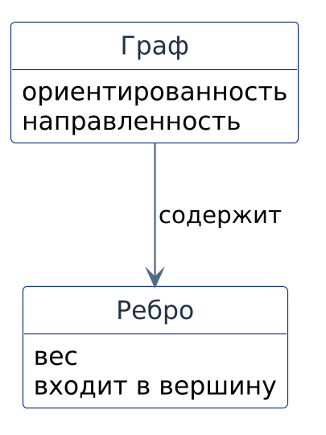
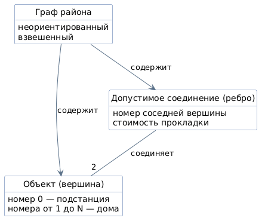

# Дизайн системы

## 1. Постановка задачи

Система анализа графов.

Система предназначена для решения и пошаговой визуализации задач анализа связности и построения структур на графах с учётом ограничений смежности и весов рёбер.

В задаче электроснабжения жилого района требуется подключить каждый дом к подстанции напрямую или через другие дома. Из допустимых соединений нужно выбрать кабели с минимальной суммарной стоимостью прокладки.

## 2. Сущности задачи

- **Граф** — набор вершин и рёбер. Для жилого района используется взвешенный неориентированный граф.
- **Вершина** — объект графа, обозначенный номером. В графе района вершина 0 соответствует подстанции, остальные вершины — домам.
- **Ребро (`Edge`)** — запись в списке смежности, которая хранит номер соседней вершины (`to`) и вес (`weight`). В графе района ребро задаёт допустимое соединение двух разных объектов, а вес — целую неотрицательную стоимость прокладки кабеля.

Исходная вершина определяется индексом списка смежности.

## 3. Архитектура

### 3.1 Набор компонентов

- Интерфейс принимает данные графа и показывает исходные данные и результат.
- Граф и вспомогательные структуры хранят вершины, рёбра и данные, необходимые алгоритмам.
- Модуль решения выполняет выбранный алгоритм и формирует результат. Для электроснабжения функция `PlanPowerSupply` в файле `PowerSupply.h` строит остов и проверяет достижимость домов от подстанции.

### 3.2 Схема связи

### 3.3 Использованные структуры

- **Взвешенность и ориентированность графа** задаются булевыми полями, чтобы использовать один класс графа для разных задач.
- **Граф со списками смежности** — для хранения вершин и рёбер: позволяет получать соседей без хранения отсутствующих связей.
- **Динамические массивы** — для списков смежности, расстояний, отметок посещения, предыдущих вершин и цветов: значения удобно получать по номеру объекта.
- **Алгоритм Дейкстры** выбран для поиска кратчайшего пути, так как он учитывает веса рёбер.
- **Алгоритм Краскала** выбран для электроснабжения, так как минимальный остов соединяет все дома с подстанцией при наименьшей суммарной стоимости кабелей.

## 4. Функциональные требования

### Граф должен позволять:

- Создавать ориентированный или неориентированный, взвешенный или невзвешенный граф.
- Добавлять рёбра между вершинами.
- Получать соседей вершины и веса связей.
- Получать количество вершин и признак взвешенности.
- Возвращать `std::nullopt` при неверном номере вершины.

### Модулю решений: 

- **Обход в ширину (BFS)** — кратчайшие пути по числу связей в невзвешенном графе.
- **Алгоритм Дейкстры** — кратчайшие пути в графе с неотрицательными весами.
- **Обход в глубину (DFS)** — поиск достижимых объектов; в неориентированном графе также позволяет найти компоненты связности.
- **Жадная раскраска** — назначение разных цветов концам каждого ребра или дуги. В ориентированном графе учитываются входящие и исходящие дуги. Минимальное число цветов не гарантируется.
- **Алгоритм Краскала** — построение минимального остовного дерева во взвешенном связном неориентированном графе.

### Система должна позволять:

1. Вводить граф вручную или генерировать его с заданными параметрами, выбирать направление рёбер и наличие весов, просматривать исходные данные.
2. Показывать результат: маршрут и расстояние, достижимые вершины, компоненты связности или цвета.
3. Сообщать, если маршрут отсутствует.
4. Задавать район вручную или генерировать его по числу домов. При ручном вводе указывать названия объектов, допустимые соединения и их стоимость.
5. Пошагово показывать выбор и пропуск кабелей, текущую стоимость и подключённые дома. Для связного района выводить список выбранных кабелей, минимальную суммарную стоимость и время работы алгоритма.
6. Если граф района несвязный, сообщать о невозможности подключения всех домов и перечислять дома, недостижимые от подстанции.

